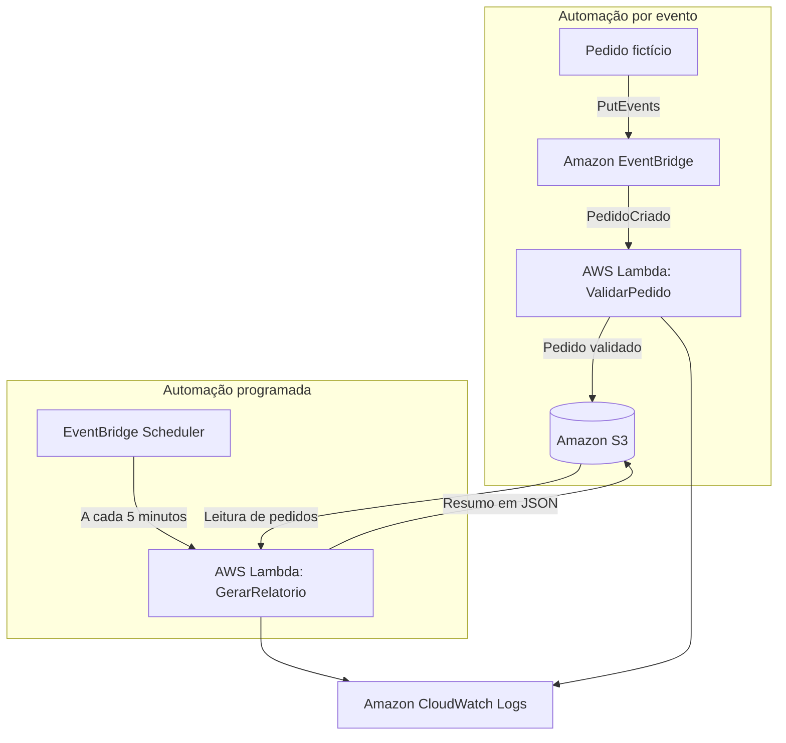

<div align="center">

# ⚡ TechCommerce
### AWS Serverless Automation

**Automação de pedidos e relatórios usando arquitetura orientada a eventos.**

[](https://aws.amazon.com/pt/lambda/)
[](https://aws.amazon.com/pt/eventbridge/)
[](https://nodejs.org/)
[](https://aws.amazon.com/pt/s3/)


**Projeto acadêmico | Cloud Computing for Software Development | UniFECAF**

**Status:** 🟡 Código e infraestrutura preparados • **implantação AWS e evidências pendentes**

</div>

---

## 🎯 O desafio

A **TechCommerce**, empresa fictícia de e-commerce, enfrenta picos de pedidos, atrasos e tarefas que dependem de servidores e intervenções manuais. O desafio é automatizar processos em nuvem **sem manter servidores dedicados para cada tarefa repetitiva**.

Este projeto implementa dois fluxos complementares:

| Evento de negócio | Automação programada |
|---|---|
| Um pedido é criado | A cada cinco minutos |
| EventBridge encaminha o evento | EventBridge Scheduler executa a Lambda |
| Lambda valida e salva no S3 | Lambda consolida os pedidos e salva o relatório |
| CloudWatch registra o resultado | CloudWatch registra a execução |

## 🏗️ Arquitetura



> **Diferencial:** o código de validação e consolidação é separado da infraestrutura e possui testes automatizados. A configuração dos serviços é reproduzível com AWS SAM (`template.yaml`).

## 🧰 Stack

**Node.js 22 · JavaScript (ES Modules) · AWS Lambda · EventBridge · EventBridge Scheduler · Amazon S3 · CloudWatch Logs · IAM · AWS SAM · GitHub Actions**

## 📂 Estrutura

```text
.
├── src/
│   ├── core/
│   │   ├── order.mjs             # validação e valores em centavos
│   │   └── report.mjs            # agregação e relatório
│   └── lambdas/
│       ├── validar-pedido.mjs    # alvo da regra EventBridge
│       └── gerar-relatorio.mjs   # alvo do Scheduler
├── scripts/
│   ├── enviar-pedido.mjs         # publica evento real na AWS
│   └── demo-local.mjs            # demonstra lógica sem usar AWS
├── examples/                    # dados de teste fictícios
├── tests/                       # testes unitários
├── docs/
│   ├── arquitetura.md
│   ├── implantacao-aws.md
│   ├── roteiro-pitch.md
│   └── evidencias/               # reservado para prints reais
├── .github/workflows/ci.yml
├── template.yaml                # infraestrutura como código (AWS SAM)
└── README.md
```

## 🚀 Executar localmente

Requisito: Node.js 22 ou superior.

```bash
npm test
npm run check
npm run demo:local
```

O demo local valida o pedido e gera um resumo na memória, **não dispara serviços AWS**. É útil para aprender e testar as regras sem custo.

### Implantar e demonstrar na AWS

> É necessário AWS CLI, AWS SAM CLI e uma conta AWS com permissões adequadas. Crie uma stack separada dos recursos do EasyFood.

```bash
npm install
sam validate --lint
sam build
sam deploy --guided
```

Em seguida:

```bash
npm run event:valid     # publica PedidoCriado no EventBridge
npm run event:invalid   # demonstra rejeição do pedido inválido
```

No console AWS, habilite temporariamente o Scheduler `techcommerce-serverless-relatorio-5min`, confirme a execução automática e desabilite depois.

📘 **[Tutorial de implantação, teste e prints](docs/implantacao-aws.md)**

## 📥 Exemplo de evento

```json
{
  "source": "techcommerce.orders",
  "detail-type": "PedidoCriado",
  "detail": {
    "orderId": "PED-2026-001",
    "customerId": "CLIENTE-DEMO-001",
    "items": [
      { "sku": "FONE-BT-001", "quantity": 2, "unitPrice": 89.90 },
      { "sku": "CABO-USB-002", "quantity": 1, "unitPrice": 29.50 }
    ]
  }
}
```

**Resultado esperado:** pedido validado no S3 com `totalCents: 20930` e `totalBRL: 209.3`. O Scheduler gera um relatório com a contagem e os valores agregados.

## ✅ Testes e qualidade

- Casos positivos e negativos de validação.
- Rejeição de identificadores inadequados e valores inconsistentes.
- Total monetário calculado em centavos para evitar somas imprecisas.
- Testes de agregação, deduplicação defensiva e relatório vazio.
- CI com verificação de sintaxe e testes unitários em cada push/PR.

Para rodar:

```bash
npm test
```

## 🔐 Segurança e boas práticas

- Permissões IAM específicas por Lambda e prefixo S3.
- Bucket privado, criptografia em repouso, expiração automática de objetos demonstrativos.
- IDs e valores fictícios, sem dados pessoais ou financeiros reais.
- Nenhuma credencial AWS versionada.
- Scheduler começa **desabilitado** e deve ser habilitado apenas para a demonstração.

## 📊 Evidências — a serem adicionadas

| Etapa | O que comprovar |
|---|---|
| Lambda | Funções criadas na conta AWS |
| EventBridge | Regra e evento publicados |
| Validação | `ORDER_VALIDATED` no CloudWatch + objeto no S3 |
| Scheduler | Horário e frequência configurados |
| Relatório | `REPORT_GENERATED` no CloudWatch + relatório no S3 |

📸 **[Checklist de evidências](docs/evidencias/README.md)**

> **Transparência:** a existência do código no GitHub não equivale à execução em nuvem. O status mudará para concluído somente após os testes reais e o registro das evidências.

## 🧠 Aprendizados

- **Event-driven:** o processamento é disparado por um evento de negócio.
- **Scheduled:** o processamento é disparado pelo tempo.
- **Serverless:** a AWS gerencia a execução e a escala de funções, sem provisionar servidores dedicados para essas tarefas.
- **Observabilidade:** os logs permitem rastrear a automação.
- **Custos:** cobrança por uso pode ser interessante em cargas variáveis, mas depende de volume, configuração e comparação econômica.

## 📚 Documentação técnica

- [Arquitetura e decisões](docs/arquitetura.md)
- [Implantação AWS](docs/implantacao-aws.md)
- [Roteiro para apresentação](docs/roteiro-pitch.md)
- [Cobertura dos requisitos acadêmicos](docs/requisitos-academicos.md)
- [Publicação no GitHub](docs/publicar-github.md)
- [AWS Lambda — Developer Guide](https://docs.aws.amazon.com/lambda/latest/dg/welcome.html)
- [Amazon EventBridge — User Guide](https://docs.aws.amazon.com/eventbridge/latest/userguide/eb-what-is.html)
- [Amazon EventBridge Scheduler](https://docs.aws.amazon.com/scheduler/latest/UserGuide/what-is-scheduler.html)

---

<div align="center">

**Desenvolvido por [Sandro Ferreira](https://github.com/sandrozdb)**  
Engenharia da Computação • Automação • Arquitetura Cloud

⭐ *Um evento acontece. A nuvem reage.*

</div>
