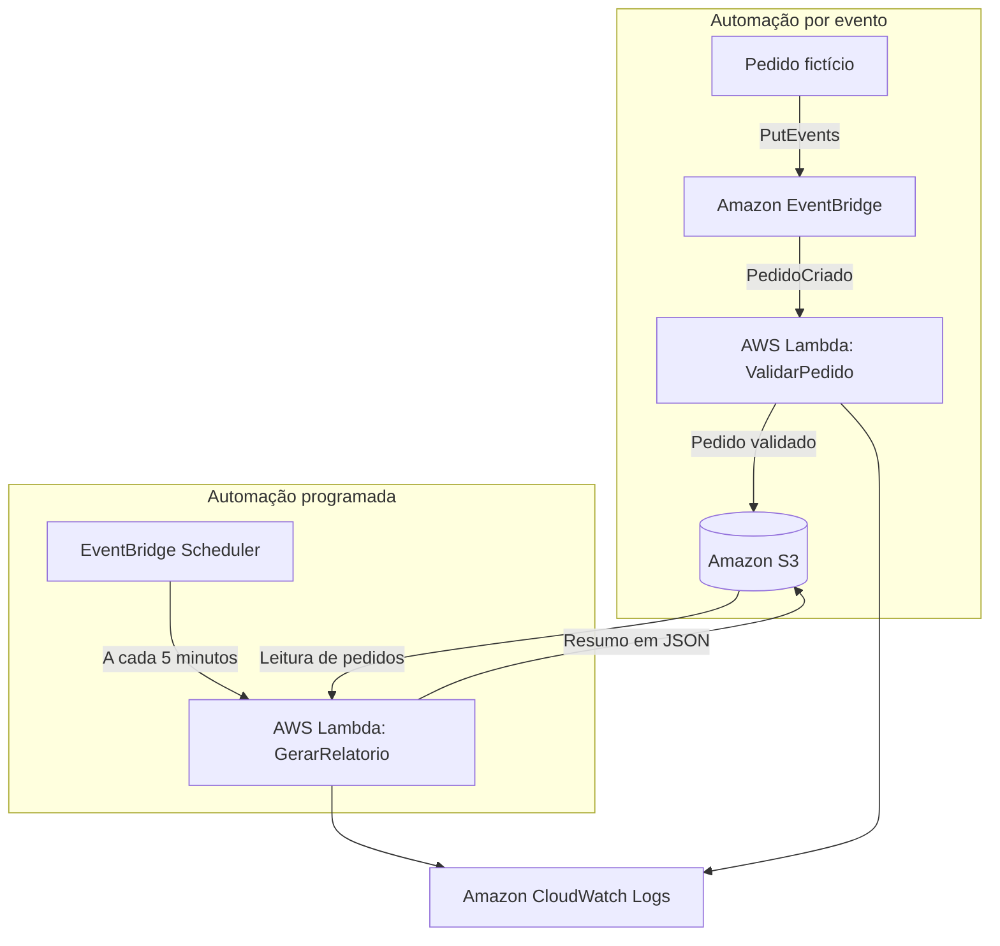

<div align="center">

# ⚡ TechCommerce
### AWS Serverless Automation

**Automação de pedidos e relatórios usando arquitetura orientada a eventos.**

[](https://aws.amazon.com/pt/lambda/)
[](https://aws.amazon.com/pt/eventbridge/)
[](https://nodejs.org/)
[](https://aws.amazon.com/pt/s3/)


**Projeto acadêmico | Cloud Computing for Software Development | UniFECAF**

**Status:** ✅ Aplicação implantada e os dois fluxos validados na AWS em 22/11/2026. **Vídeo pitch publicado; relatório acadêmico preparado para a entrega.**

</div>

---

## 🎯 O desafio

A **TechCommerce**, empresa fictícia de e-commerce, enfrenta picos de pedidos, atrasos e tarefas que dependem de servidores e intervenções manuais. O desafio é automatizar processos em nuvem **sem manter servidores dedicados para cada tarefa repetitiva**.

Este projeto implementa dois fluxos complementares:

| Evento de negócio | Automação programada |
|---|---|
| Um pedido é criado | A cada cinco minutos |
| EventBridge encaminha o evento | EventBridge Scheduler executa a Lambda |
| Lambda valida e salva no S3 | Lambda consolida os pedidos e salva o relatório |
| CloudWatch registra o resultado | CloudWatch registra a execução |

## 🏗️ Arquitetura



> **Diferencial:** o código de validação e consolidação é separado da infraestrutura e possui testes automatizados. A configuração dos serviços é reproduzível com AWS SAM (`template.yaml`).

## 🧰 Stack

**Node.js 22 · JavaScript (ES Modules) · AWS Lambda · EventBridge · EventBridge Scheduler · Amazon S3 · CloudWatch Logs · IAM · AWS SAM · GitHub Actions**

## 📂 Estrutura

```text
.
├── src/
│   ├── core/
│   │   ├── order.mjs             # validação e valores em centavos
│   │   └── report.mjs            # agregação e relatório
│   └── lambdas/
│       ├── validar-pedido.mjs    # alvo da regra EventBridge
│       └── gerar-relatorio.mjs   # alvo do Scheduler
├── scripts/
│   ├── enviar-pedido.mjs         # publica evento real na AWS
│   └── demo-local.mjs            # demonstra lógica sem usar AWS
├── examples/                    # dados de teste fictícios
├── tests/                       # testes unitários
├── docs/
│   ├── arquitetura.md
│   ├── implantacao-aws.md
│   ├── roteiro-pitch.md
│   └── evidencias/               # reservado para prints reais
├── .github/workflows/ci.yml
├── template.yaml                # infraestrutura como código (AWS SAM)
└── README.md
```

## 🚀 Executar localmente

Requisito: Node.js 22 ou superior.

```bash
npm test
npm run check
npm run demo:local
```

O demo local valida o pedido e gera um resumo na memória, **não dispara serviços AWS**. É útil para aprender e testar as regras sem custo.

### Implantar e demonstrar na AWS

> É necessário AWS CLI, AWS SAM CLI e uma conta AWS com permissões adequadas. Crie uma stack separada dos recursos do EasyFood.

```bash
npm install
sam validate --lint
sam build
sam deploy --guided
```

Em seguida:

```bash
npm run event:valid     # publica PedidoCriado no EventBridge
npm run event:invalid   # demonstra rejeição do pedido inválido
```

No console AWS, habilite temporariamente o Scheduler `techcommerce-serverless-relatorio-5min`, confirme a execução automática e desabilite depois.

📘 **[Tutorial de implantação, teste e prints](docs/implantacao-aws.md)**

## 📥 Exemplo de evento

```json
{
  "source": "techcommerce.orders",
  "detail-type": "PedidoCriado",
  "detail": {
    "orderId": "PED-2026-001",
    "customerId": "CLIENTE-DEMO-001",
    "items": [
      { "sku": "FONE-BT-001", "quantity": 2, "unitPrice": 89.90 },
      { "sku": "CABO-USB-002", "quantity": 1, "unitPrice": 29.50 }
    ]
  }
}
```

**Resultado esperado:** pedido validado no S3 com `totalCents: 20930` e `totalBRL: 209.3`. O Scheduler gera um relatório com a contagem e os valores agregados.

## ✅ Testes e qualidade

- Casos positivos e negativos de validação.
- Rejeição de identificadores inadequados e valores inconsistentes.
- Total monetário calculado em centavos para evitar somas imprecisas.
- Testes de agregação, deduplicação defensiva e relatório vazio.
- CI com verificação de sintaxe e testes unitários em cada push/PR.

Para rodar:

```bash
npm test
```

## 🔐 Segurança e boas práticas

- Permissões IAM específicas por Lambda e prefixo S3.
- Bucket privado, criptografia em repouso, expiração automática de objetos demonstrativos.
- IDs e valores fictícios, sem dados pessoais ou financeiros reais.
- Nenhuma credencial AWS versionada.
- Scheduler começa **desabilitado** e deve ser habilitado apenas para a demonstração.

## 📊 Resultados reais e evidências — 22/11/2026

A aplicação foi implantada via AWS SAM na stack `techcommerce-serverless`, região `sa-east-1`.

| Verificação | Resultado observado |
|---|---|
| Testes locais | 13 aprovados, 0 falhas; `sam validate --lint` e `sam build` aprovados |
| Publicação de evento | `PedidoCriado` aceito no barramento `techcommerce-events`; pedido `PED-2026-001` |
| Lambda de pedidos | CloudWatch registrou `ORDER_VALIDATED` em 22/11/2026, às 14:20:44 UTC |
| Pedido no S3 | `orders/validated/PED-2026-001.json`, com `status: VALIDADO` e total de R$ 209,30 |
| Agendamento | `rate(5 minutes)`; execução automática comprovada e posteriormente desabilitada |
| Lambda de relatórios | CloudWatch registrou `REPORT_GENERATED` em 22/11/2026, às 14:24:33 UTC |
| Relatório no S3 | `reports/summary-2026-11-22T14-24-33-473Z.json`, com 1 pedido, 3 itens, R$ 209,30 e 0 duplicatas |

A execução dos dois fluxos foi verificada com logs e leitura dos objetos JSON no S3. O Scheduler permanece **DISABLED** após a demonstração para evitar execuções desnecessárias.

📸 **[Relação das oito capturas de evidência](docs/evidencias/README.md)**

> **Transparência:** a implantação e a execução na AWS foram comprovadas em ambiente de demonstração com dados fictícios. As capturas foram coletadas para o relatório acadêmico e **ainda não foram adicionadas à pasta `docs/evidencias/` do GitHub**. O vídeo pitch está publicado; a validação de acesso, a verificação dos critérios da disciplina e a submissão acadêmica permanecem sob responsabilidade do autor. Não se trata de sistema comercial em produção.

## 🧠 Aprendizados

- **Event-driven:** o processamento é disparado por um evento de negócio.
- **Scheduled:** o processamento é disparado pelo tempo.
- **Serverless:** a AWS gerencia a execução e a escala de funções, sem provisionar servidores dedicados para essas tarefas.
- **Observabilidade:** os logs permitem rastrear a automação.
- **Custos:** cobrança por uso pode ser interessante em cargas variáveis, mas depende de volume, configuração e comparação econômica.

## 🎥 Vídeo pitch e relatório acadêmico

- **Vídeo publicado:** [Assistir ao TechCommerce no YouTube Shorts](https://www.youtube.com/shorts/Zw6rOMZwtXU).
- **Relatório acadêmico:** versão final preparada com as oito capturas da AWS, a URL do repositório e o link do vídeo.
- **Verificação de entrega:** confirmar duração e acesso ao vídeo sem login e revisar se a apresentação atende à exigência de demonstração prática. A submissão ao ambiente acadêmico não foi realizada aqui.

## 📚 Documentação técnica

- [Arquitetura e decisões](docs/arquitetura.md)
- [Implantação AWS](docs/implantacao-aws.md)
- [Roteiro para apresentação](docs/roteiro-pitch.md)
- [Cobertura dos requisitos acadêmicos](docs/requisitos-academicos.md)
- [Publicação no GitHub](docs/publicar-github.md)
- [AWS Lambda — Developer Guide](https://docs.aws.amazon.com/lambda/latest/dg/welcome.html)
- [Amazon EventBridge — User Guide](https://docs.aws.amazon.com/eventbridge/latest/userguide/eb-what-is.html)
- [Amazon EventBridge Scheduler](https://docs.aws.amazon.com/scheduler/latest/UserGuide/what-is-scheduler.html)

---

<div align="center">

**Desenvolvido por [Sandro Ferreira](https://github.com/sandrozdb)**  
Engenharia da Computação • Automação • Arquitetura Cloud

⭐ *Um evento acontece. A nuvem reage.*

</div>
