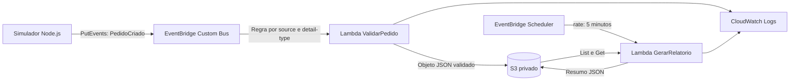

# Arquitetura técnica — TechCommerce

## Objetivo
Desacoplar tarefas de validação de pedidos e geração de relatórios usando funções serverless, automação por evento e automação programada.

## Visão geral

## Contrato de evento
- `source`: `techcommerce.orders`
- `detail-type`: `PedidoCriado`
- `detail`: `{ orderId, customerId, items: [{ sku, quantity, unitPrice }] }`
- A Lambda calcula o valor com precisão de centavos; ignora totais financeiros enviados pelo cliente.

## Regras e decisões
1. **Validação:** pedido precisa de identificadores seguros, entre 1 e 50 itens, quantidade positiva e preço positivo com até duas casas decimais.
2. **Persistência:** pedidos aprovados ficam em `orders/validated/<orderId>.json` no S3. Repetir o ID sobrescreve a chave e evita duplicidade de contagem, mas não impede atualizações conflitantes: é uma limitação do protótipo.
3. **Rejeição:** pedidos inválidos produzem logs estruturados `ORDER_REJECTED` e não são gravados.
4. **Agendamento:** a cada cinco minutos, durante a demonstração, o Scheduler executa `GerarRelatorio`. Ele começa desabilitado.
5. **Relatório:** a função agrega até 1.000 objetos de pedidos válidos no bucket e grava `reports/summary-<timestamp>.json`.

## Segurança e responsabilidade
- Papéis IAM separados e permissões limitadas a prefixos do bucket.
- Bucket privado, bloqueio público e criptografia em repouso.
- IAM do Scheduler restrito à Lambda de relatório.
- Dados totalmente fictícios, sem CPF, dados bancários ou credenciais.
- Objetos demonstrativos expiram após sete dias.
- O projeto não implementa pagamentos reais, DLQ, tracing distribuído ou SLAs de produção.

## Resiliência e custos
EventBridge desacopla o produtor do processamento. Lambda escala conforme demanda, observadas as cotas AWS. Para produção, seriam necessários DLQ, alarmes, política de reprocessamento e deduplicação transacional. **Não se deve afirmar economia financeira sem comparação de custos e demanda.**

## Relação com o enunciado

| Exigência | Evidência planejada |
|---|---|
| Lambda | Duas funções e logs |
| Eventos | Regra `PedidoCriado` e publicação via `PutEvents` |
| Agendamento | `rate(5 minutes)` e execução automática |
| Arquitetura | Diagrama e stack SAM |
| Benefícios | Decisões técnicas, limites e custos |
| Demonstração | CloudWatch e objetos S3 |

**Atenção:** evidências AWS só existirão após implantação e testes reais.
